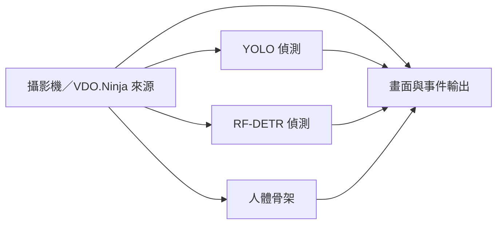

# 在 ComfyUI 串接視覺工作流

ComfyUI 負責畫布、節點連接與操作；Vision Workbench 提供已登錄的模型、微調權重、素材、OpenCV、時序規則與推論佇列。兩個服務需要同時執行。這個橋接不會把大型模型複製到 ComfyUI，也不會將 ComfyUI 的 PyTorch 環境改成工作檯的環境。

## 安裝與開啟

1. 先在 Vision Workbench 執行 `python launch.py`，確認 `http://127.0.0.1:8765/` 能開啟。
2. 在本專案目錄執行以下安裝與範例匯出指令。將 `<ComfyUI>` 換成含有 `main.py`、`folder_paths.py` 的既有 ComfyUI 目錄；Windows portable 通常是 `ComfyUI_windows_portable/ComfyUI`。

   ```console
   python install_comfyui.py --comfy-root "<ComfyUI>"
   python export_workflow_templates.py --destination "<ComfyUI>/user/default/workflows/VisionWorkbench"
   ```

   安裝器會將橋接放到 `custom_nodes/vision_workbench`，變更既有檔案前保留備份。匯出器需要工作檯服務已啟動；會輸出 15 個範例 JSON，並帶入這台電腦已登錄的模型與素材 ID。也可以手動複製 `comfyui/vision_workbench` 資料夾。
3. 啟動或重新啟動 ComfyUI，開啟它顯示的本機網址；預設為 `http://127.0.0.1:8188/`。
4. 在節點搜尋中輸入 `Vision Workbench`，即可找到 31 種原生 ComfyUI 節點；從 `Vision Workbench` 側欄載入 15 個預設流程，或開啟剛匯出的工作流檔案。

安裝完成後可直接開啟[雙模型＋人體骨架攝影機範例](http://127.0.0.1:8188/?vision_workflow=live-multi-model&source=camera)。網址中的 `vision_workflow` 選擇模板，`source=camera` 指定攝影機來源；只會載入流程，仍需執行並手動連接攝影機。

本機位址是兩個服務的通訊位置。手機 VDO.Ninja 連線在即時頁面設定；不用讓手機直接存取 ComfyUI 的 `127.0.0.1`。

## 既有資源怎麼使用

| 資源 | ComfyUI 中的入口 | 檔案位置與限制 |
|---|---|---|
| 原始模型 | 模型節點的 `model_id` | 選單來自工作檯模型登錄；實際推論仍使用工作檯環境 |
| 已微調模型 | 模型節點的 `checkpoint_id` | 使用已登錄且相容的 checkpoint；偵測節點也接受原模型＋新分支模型包，無須搬移權重 |
| 圖片／影片 | 來源節點的 `media_id` | 引用工作檯素材庫；上傳與新增素材仍可在工作檯完成 |
| OpenCV | `VisionWB_cv_*` 節點 | 使用目前工作檯的 OpenCV 實作與參數驗證 |
| 姿態、動作、關係與事件 | 對應 `VisionWB_*` 節點 | 與工作檯相同的權重、類別與資料型別限制 |
| DINOv3 視覺表徵／分類 | `VisionWB_embedding` | CLS 向量可接輸出；分類 checkpoint 另有可接條件規則的類別狀態 |
| 預設工作流 | 範例入口 | 將工作檯節點轉成 ComfyUI 節點，連同合適素材和建議取樣設定 |

節點類別 ID 使用 `VisionWB_` 前綴，例如 `VisionWB_source`、`VisionWB_detector`、`VisionWB_pose`、`VisionWB_tracker`、`VisionWB_output`。選單顯示名稱與登錄 ID；執行時依 ID 解析目前登錄的本機檔案。工作流 JSON 不保存 API 金鑰或模型檔案的私有路徑。

DINOv3 原始模型輸出特徵向量，並不自帶任意物件的分類名稱；選擇已有分類頭的微調 checkpoint 才會輸出對應影像類別。向量可選擇 L2 正規化並保存於影格 JSONL；畫面顯示維度與取樣時間。影片／即時來源可設定推論間隔，並在來源變更或斷訊後重新取樣。權重尚未下載或登錄時會在預檢回報缺少資源，不會以假結果代替。

微調權重必須符合所選模型的架構及工作類型。偵測節點可使用「原模型＋新分支」模型包，同時執行兩個分支，保留各自類別與分數；動作辨識和視覺表徵節點仍不接受雙分支模型包。任意第三方 ComfyUI 節點也不會自動變成工作檯模型。

## 圖片與影片

1. 載入一個範例，或放入來源、處理／模型與輸出節點。
2. 來源的 `source_mode` 選 `media`，並選擇對應圖片或影片。
3. 調整模型、checkpoint、閾值或 OpenCV 參數，再執行 ComfyUI 工作流。
4. 輸出節點會把這張視覺流程送進工作檯佇列，回傳實際結果圖片／報告；影片與事件檔案由工作檯保存。

「影像」連線決定模型收到的畫面。裁切、縮放或旋轉可以放在模型前，偵測框與骨架等幾何資料依工作檯的座標轉換規則對齊。將原始來源另接輸出畫面，就能在原圖上檢視處理後分支的結果。

## 同一支攝影機接多個模型

可從一個來源分出多路，例如：



1. 把來源的 `source_mode` 改為 `camera` 或 `vdo`。
2. 把來源的影像輸出接到需要的模型；各模型的偵測框／骨架接入畫面輸出的對應插槽。
3. 執行 ComfyUI 流程；`VisionWB_output` 輸出節點內會嵌入即時檢視器，直接在節點中查看來源與模型結果。
4. 在檢視器選擇 USB／內建／虛擬攝影機，或貼入 VDO.Ninja 觀看連結。先連接取得預覽，再按開始執行。

載入工作流或打開檢視器不會自動啟用攝影機。即時檢視器使用同一份固定流程快照；修改 ComfyUI 節點後，重新執行才能套用新流程。停止或離開即時執行頁會清理攝影機與即時工作。

多路模型的更新速度取決於整張流程的成本。30 FPS 的攝影機預覽不代表多個大模型都能每秒完成 30 次推論；工作檯採用最新影格並顯示實際處理速度。

## 範例素材的對應

範例入口會標示使用哪張圖片或哪段影片，以及能觀察到什麼。來源專案有可用示範時，保留來源與素材授權資訊；沒有合適素材時，會明確要求上傳自己的場景，或使用攝影機，不會任意套用另一張圖片。

開源原始碼不代表其中所有影片與圖片也允許重新散布。部分原作者示範只在使用者本機下載及登錄；公開原始碼包只包含已有明確再散布條件的素材。PPE、跌倒等範例尤其需要符合目標任務的影像，普通交通或人物影片不能當作正向示範證據。

## 常見問題

- **選單沒有模型或素材**：先確認工作檯服務已啟動、資源已登錄，再重新整理 ComfyUI 的資源清單或重新啟動 ComfyUI。
- **有節點但執行失敗**：檢查工作檯回傳的權重、環境、輸入類型或必接插槽錯誤；ComfyUI 的正常啟動不代表每個模型環境都已安裝。
- **新類別沒有出現**：確認選了對應模型的微調 checkpoint，而不是原始預訓練權重。
- **攝影機畫面有、結果慢**：先減少模型數或縮小輸入尺寸，再檢查實際推論時間；背景減除與光流仍使用來源時間判斷。
- **原生工作檯還能用嗎**：可以。原生畫布與 ComfyUI 都使用工作檯服務；既有推論比較、資料集與訓練入口保留。
