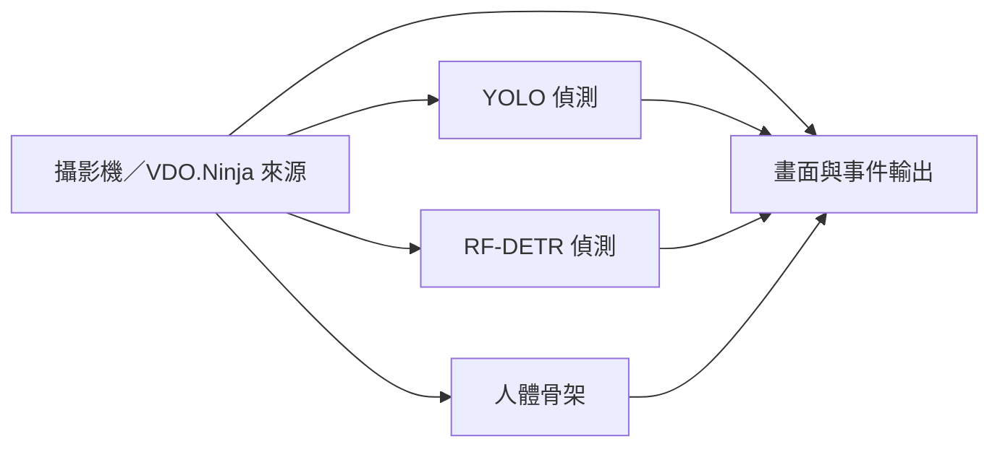

# 在 ComfyUI 串接視覺工作流

ComfyUI 負責畫布、節點連接與操作；Vision Workbench 提供已登錄的模型、微調權重、素材、OpenCV、時序規則與推論佇列。兩個服務需要同時執行。這個橋接不會把大型模型複製到 ComfyUI，也不會將 ComfyUI 的 PyTorch 環境改成工作檯的環境。

## 安裝與開啟

先安裝 Python **3.10–3.12**（建議 3.11）及 Node.js **20 或以上**。在下載／解壓後的專案目錄執行：

```console
python setup.py
python setup.py --install
python launch.py
```

第一行只顯示計畫；第二行才下載與安裝。完整 `full` 安裝預設包含 ComfyUI，明確寫成 `python setup.py --install --with-comfyui` 也可以。Windows 可直接雙擊 `INSTALL_AND_START.cmd` 完成安裝及啟動，之後雙擊 `START.cmd`。這些入口不會替電腦安裝 Python 或 Node.js。

安裝器會優先沿用既有 ComfyUI；找不到時，下載固定版本的 [ComfyUI 官方原始碼](https://github.com/Comfy-Org/ComfyUI)，核對 SHA256，建立專案專用的環境。依賴隔離方式遵循 [ComfyUI 官方手動安裝指南](https://docs.comfy.org/installation/manual_install)；此專案另固定版本及下載檢查，以便重現。

| 項目 | 自動安裝／啟動的處理方式 |
|---|---|
| ComfyUI 本體 | 新安裝位於 `.tools/ComfyUI/`；既有安裝不會被替換或自動更新 |
| ComfyUI Python 環境 | 新安裝位於 `.tools/comfyui-venv/`，與工作檯 `.venv/` 分開 |
| 模型執行環境 | `VisionWB_*` 模型仍由工作檯的 GPU／CPU 環境執行 |
| 自訂節點 | 安裝到 ComfyUI 的 `custom_nodes/vision_workbench/`；變更既有檔案前備份 |
| 範例 | 啟動工作檯後匯出 18 個中文名稱流程至 ComfyUI 的 `user/default/workflows/VisionWorkbench/`；包含目前電腦登錄的素材與模型 ID |
| 本機設定 | 保存於專案 `runtime/comfyui.json`，不加入 Git 或匯出的工作流 |
| 啟動 | `python launch.py` 沿用已在運行的相容服務，或啟動兩個服務並開啟 ComfyUI |

新建的 ComfyUI 使用 CPU 版 PyTorch，供畫布、工作排程與預覽使用；辨識及微調的 GPU 能力由工作檯決定。其他 ComfyUI 生圖節點在這個新環境中也使用 CPU。若已有用於生圖的 CUDA／其他 GPU ComfyUI，請沿用該安裝，安裝器不修改它的 Python 套件或驅動。

GitHub ZIP／Git clone 不包含 ComfyUI 本體、Python 環境或大型模型權重；執行 `--install` 才取得 ComfyUI 與套件。請預留環境、下載暫存及模型所需空間；套件下載量會隨平台而異，模型權重仍需依各自的授權另外取得。來源下載、安裝或環境驗證失敗時會回報原因，不會將未完成安裝當作可啟動設定。

啟動後，在節點搜尋輸入 `Vision Workbench` 即可找到 35 種原生節點；從 `Vision Workbench` 側欄或工作流檔案清單載入 18 個預設流程。工作檯網址為 `http://127.0.0.1:8765/`，ComfyUI 為 `http://127.0.0.1:8188/`，兩者只監聽本機。

工作流檔名與畫布標題包含中文名稱，方便識別用途。重新匯出會保留修改過或無法確認來源的檔案，另外建立新版預設；確認未修改的舊產生檔才會移至 `.backups`。新增的 [辦公室跨線／坐姿規則](office-camera.md) 與 [洗手兩種模板](handwashing-models.md) 都可使用即時來源。手部骨架與 SAM 遮罩節點目前僅提供推論，沒有微調接頭。

### 沿用其他位置的 ComfyUI

自動偵測找不到安裝時，可明確指定。`<ComfyUI>` 是含有 `main.py`、`folder_paths.py` 的目錄；`<Python>` 是該安裝實際使用的 Python 執行檔：

```console
python setup.py --install --with-comfyui --comfy-root "<ComfyUI>" --comfy-python "<Python>"
python launch.py --with-comfyui
```

例如 Windows portable 的核心通常位於 `ComfyUI_windows_portable/ComfyUI`，Python 位於相鄰的 `python_embeded/python.exe`。若安裝器無法確認 Python 或依賴缺少，會提示先修復該 ComfyUI；不會在不明環境中直接執行 pip 安裝。

### 只啟動工作檯或手動管理服務

```console
# 完整工作檯環境，但略過 ComfyUI
python setup.py --install --without-comfyui

# 已配置 ComfyUI，這次只啟動工作檯
python launch.py --without-comfyui

# 啟動已配置服務，不開啟瀏覽器
python launch.py --no-browser
```

`--profile base` 預設不安裝 ComfyUI；可加 `--with-comfyui` 安裝，但 `base` 仍缺少多數模型執行依賴。若自行管理服務，也保留以下橋接／匯出工具；匯出前需要工作檯已在運行：

```console
python install_comfyui.py --comfy-root "<ComfyUI>"
python export_workflow_templates.py --destination "<ComfyUI>/user/default/workflows/VisionWorkbench"
```

手動安裝橋接後，若 ComfyUI 已在運行，請自行在空閒時重啟以載入節點；啟動器不會終止既有服務或正在執行的任務。

安裝完成後可直接開啟[雙模型＋人體骨架攝影機範例](http://127.0.0.1:8188/?vision_workflow=live-multi-model&source=camera)。網址中的 `vision_workflow` 選擇模板，`source=camera` 指定攝影機來源；只會載入流程，仍需執行並手動連接攝影機。

本機位址是兩個服務的通訊位置。手機 VDO.Ninja 連線在即時頁面設定；不用讓手機直接存取 ComfyUI 的 `127.0.0.1`。

## 既有資源怎麼使用

| 資源 | ComfyUI 中的入口 | 檔案位置與限制 |
|---|---|---|
| 原始模型 | 模型節點的 `model_id` | 選單來自工作檯模型登錄；實際推論仍使用工作檯環境 |
| 已微調模型 | 模型節點的 `checkpoint_id` | 使用已登錄且相容的 checkpoint；偵測節點也接受原模型＋新分支模型包，無須搬移權重 |
| 圖片／影片 | 來源節點的 `media_id` | 引用工作檯素材庫；上傳與新增素材仍可在工作檯完成 |
| OpenCV | `VisionWB_cv_*` 節點 | 使用目前工作檯的 OpenCV 實作與參數驗證 |
| 姿態、動作、關係與事件 | 對應 `VisionWB_*` 節點 | 與工作檯相同的權重、類別與資料型別限制 |
| DINOv3 視覺表徵／分類 | `VisionWB_embedding` | CLS 向量可接輸出；分類 checkpoint 另有可接條件規則的類別狀態 |
| 預設工作流 | 範例入口 | 將工作檯節點轉成 ComfyUI 節點，連同合適素材和建議取樣設定 |

節點類別 ID 使用 `VisionWB_` 前綴，例如 `VisionWB_source`、`VisionWB_detector`、`VisionWB_pose`、`VisionWB_tracker`、`VisionWB_output`。選單顯示名稱與登錄 ID；執行時依 ID 解析目前登錄的本機檔案。工作流 JSON 不保存 API 金鑰或模型檔案的私有路徑。

DINOv3 原始模型輸出特徵向量，並不自帶任意物件的分類名稱；選擇已有分類頭的微調 checkpoint 才會輸出對應影像類別。向量可選擇 L2 正規化並保存於影格 JSONL；畫面顯示維度與取樣時間。影片／即時來源可設定推論間隔，並在來源變更或斷訊後重新取樣。權重尚未下載或登錄時會在預檢回報缺少資源，不會以假結果代替。

微調權重必須符合所選模型的架構及工作類型。偵測節點可使用「原模型＋新分支」模型包，同時執行兩個分支，保留各自類別與分數；動作辨識和視覺表徵節點仍不接受雙分支模型包。任意第三方 ComfyUI 節點也不會自動變成工作檯模型。

## 圖片與影片

1. 載入一個範例，或放入來源、處理／模型與輸出節點。
2. 來源的 `source_mode` 選 `media`，並選擇對應圖片或影片。
3. 調整模型、checkpoint、閾值或 OpenCV 參數，再執行 ComfyUI 工作流。
4. 輸出節點會把這張視覺流程送進工作檯佇列，回傳實際結果圖片／報告；影片與事件檔案由工作檯保存。

「影像」連線決定模型收到的畫面。裁切、縮放或旋轉可以放在模型前，偵測框與骨架等幾何資料依工作檯的座標轉換規則對齊。將原始來源另接輸出畫面，就能在原圖上檢視處理後分支的結果。

## 同一支攝影機接多個模型

可從一個來源分出多路，例如：



1. 把來源的 `source_mode` 改為 `camera` 或 `vdo`。
2. 把來源的影像輸出接到需要的模型；各模型的偵測框／骨架接入畫面輸出的對應插槽。
3. 執行 ComfyUI 流程；`VisionWB_output` 輸出節點內會嵌入即時檢視器，直接在節點中查看來源與模型結果。
4. 在檢視器選擇 USB／內建／虛擬攝影機，或貼入 VDO.Ninja 觀看連結。先連接取得預覽，再按開始執行；「放大即時畫面」可放大同一個檢視器，按 Esc 返回。

載入工作流或打開檢視器不會自動啟用攝影機。即時檢視器使用同一份固定流程快照；修改 ComfyUI 節點後，重新執行才能套用新流程。停止或離開即時執行頁會清理攝影機與即時工作。

多路模型的更新速度取決於整張流程的成本。30 FPS 的攝影機預覽不代表多個大模型都能每秒完成 30 次推論；工作檯採用最新影格並顯示實際處理速度。

## 範例素材的對應

範例入口會標示使用哪張圖片或哪段影片，以及能觀察到什麼。來源專案有可用示範時，保留來源與素材授權資訊；沒有合適素材時，會明確要求上傳自己的場景，或使用攝影機，不會任意套用另一張圖片。

開源原始碼不代表其中所有影片與圖片也允許重新散布。部分原作者示範只在使用者本機下載及登錄；公開原始碼包只包含已有明確再散布條件的素材。PPE、跌倒等範例尤其需要符合目標任務的影像，普通交通或人物影片不能當作正向示範證據。

## 常見問題

- **下載專案後為何還需要下載**：原始碼包包含安裝工具。ComfyUI、Python 套件在首次安裝時取得，模型權重是另一項下載。
- **ComfyUI 已在運行卻無法沿用**：啟動器會檢查工作檯節點是否存在。若是尚未載入橋接的 ComfyUI，請等任務結束後自行重啟；若 8188 是別的服務，請先處理埠衝突。啟動器不會強制關閉其他程式。
- **為何新 ComfyUI 顯示 CPU**：新環境用於畫布及橋接；Vision Workbench 的模型仍可用其 CUDA 環境。其他原生 ComfyUI GPU 節點請使用自行配置的 GPU ComfyUI。
- **安裝失敗怎麼重試**：閱讀錯誤指出的下載、Python、依賴或路徑問題，修復後重新執行同一安裝命令；不要把工作檯和 ComfyUI 的套件混裝到同一環境。
- **選單沒有模型或素材**：先確認工作檯服務已啟動、資源已登錄，再重新整理 ComfyUI 的資源清單或重新啟動 ComfyUI。
- **有節點但執行失敗**：檢查工作檯回傳的權重、環境、輸入類型或必接插槽錯誤；ComfyUI 的正常啟動不代表每個模型環境都已安裝。
- **新類別沒有出現**：確認選了對應模型的微調 checkpoint，而不是原始預訓練權重。
- **攝影機畫面有、結果慢**：先減少模型數或縮小輸入尺寸，再檢查實際推論時間；背景減除與光流仍使用來源時間判斷。
- **原生工作檯還能用嗎**：可以。原生畫布與 ComfyUI 都使用工作檯服務；既有推論比較、資料集與訓練入口保留。
